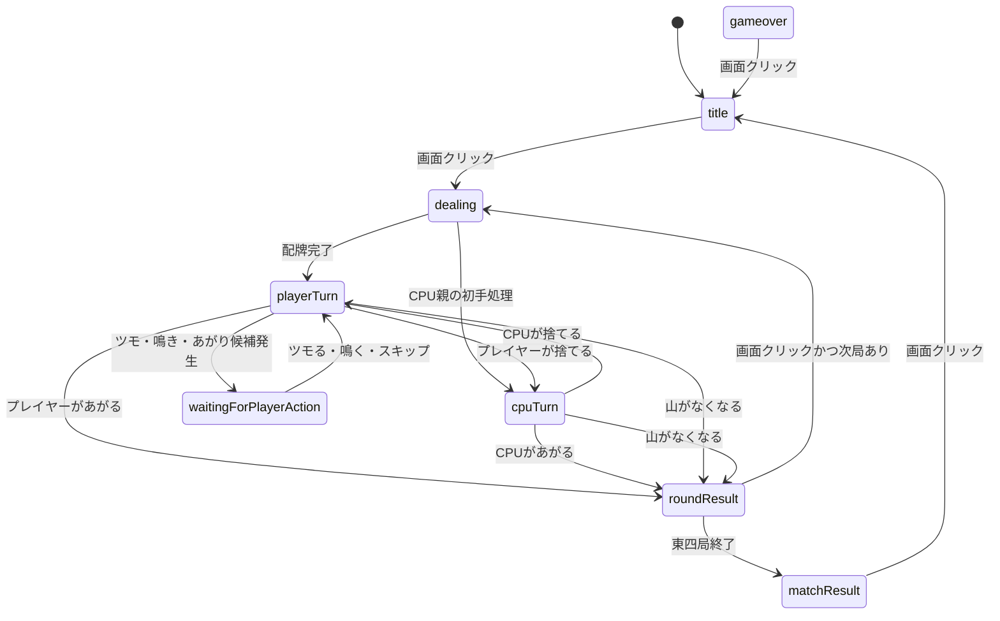

# 麻雀ゲーム設計書

## 1. 設計方針

- 対象ゲームは「二人麻雀」とする。
- 既存の的あてゲームとは別URL `/double_maajan` で起動する。
- 既存ゲームのコードや状態を共有せず、麻雀ゲーム専用のエントリポイント・シーン・状態管理を用意する。
- PhaserのSceneを中心に、画面表示・入力・対局進行・CPU処理を分離する。
- 牌は画像アセットを使わず、四角形・文字・図形から生成する。

## 2. URLとエントリ構成

### 2.1 URL

- 的あてゲームのURLは既存のURLを維持する。
- 麻雀ゲームは `/double_maajan` で起動する。
- URLパスによって起動するGameConfigまたはルートSceneを切り替える。
- 麻雀ゲームを起動した場合、的あてゲームのSceneを登録・実行しない。

### 2.2 想定ファイル構成

```text
src/
  main.ts                 # URL判定とゲーム起動
  scenes/
    GameScene.ts          # 既存の的あてゲーム
    MahjongScene.ts       # 麻雀ゲーム全体のScene
  mahjong/
    types.ts              # 牌・手牌・局状態などの型
    tiles.ts              # 136枚の牌山生成と牌表記
    hand.ts               # 手牌整理・待ち・あがり判定
    scoring.ts            # 翻数と簡易点数表
    cpu.ts                # CPUの捨て牌・鳴き・リーチ判断
    round.ts              # 局進行・親・点数移動
    rendering.ts           # 牌・手牌・捨て牌の描画
```

## 3. ゲーム状態

```ts
type MahjongState =
  | 'title'
  | 'dealing'
  | 'playerTurn'
  | 'waitingForPlayerAction'
  | 'cpuTurn'
  | 'roundResult'
  | 'matchResult'
  | 'gameover';
```

### 3.1 状態遷移



- タイトル画面中央に「二人麻雀」「クリックで始める」を表示する。
- タイトル画面をクリックすると対局を開始する。
- 対局終了画面には、ゲームクリアまたはゲームオーバー、親・子の最終持ち点、勝敗、「クリックでタイトルへもどる」を表示する。
- 対局終了画面をクリックするとタイトルへ戻る。
- 局結果画面では、あがり時のみ結果を表示する。流局時は結果を表示しない。
- 局結果画面をクリックすると、次局がある場合は次局を開始する。

## 4. 主要データ構造

### 4.1 牌

```ts
type TileSuit = 'manzu' | 'pinzu' | 'souzu' | 'honor';
type HonorTile = 'east' | 'south' | 'west' | 'north' | 'white' | 'green' | 'red';

type Tile = {
  id: number;             // 136枚中で一意
  suit: TileSuit;
  rank?: number;          // 数牌は1から9
  honor?: HonorTile;      // 字牌のみ
  visible: boolean;
};
```

- 136枚は萬子・筒子・索子の1から9を各4枚、字牌7種を各4枚で構成する。
- 赤ドラは作らない。
- 牌の表記は数牌を「一萬」「二筒」「三索」、字牌を「東」「南」「西」「北」「白」「發」「中」とする。
- 数牌の表示色は萬子を赤、筒子を青、索子を緑とする。
- 字牌の表示色は黒とする。

### 4.2 手牌と公開面子

```ts
type MeldType = 'pon' | 'chi' | 'kan';

type Meld = {
  type: MeldType;
  tiles: Tile[];
  open: boolean;
};

type Hand = {
  concealed: Tile[];
  melds: Meld[];
  discardTiles: Tile[];
  drawnTile?: Tile;
  isRiichi: boolean;
  isDoubleRiichi: boolean;
  isFuriten: boolean;
};
```

- プレイヤーの手牌は種類・数字順に自動整列する。
- CPUの手牌は裏向きで種類を見せない。
- プレイヤーの鳴き牌は手牌の右側、CPUの鳴き牌は左側へ分離する。
- 二人麻雀のため、鳴き牌はすべて同じ向きで描画する。
- 鳴いた牌とリーチ後の牌は表向きで表示する。

### 4.3 プレイヤー・CPU・局

```ts
type Participant = {
  name: 'player' | 'cpu';
  points: number;
  hand: Hand;
  isDealer: boolean;
};

type RoundState = {
  wind: 'east';
  roundNumber: 1 | 2 | 3 | 4;
  dealer: 'player' | 'cpu';
  wall: Tile[];
  deadWall: Tile[];
  doraIndicator: Tile;
  riichiSticks: number;
  isAgari: boolean;
  isDraw: boolean;
};
```

- 初期点数は親・子ともに25,000点。
- 東一局の親はランダムに決定する。
- 親があがった場合のみ同じ親で連荘する。
- 親があがらなかった場合と流局時は親を交代する。
- 東四局終了後に最終結果を判定する。

## 5. 牌山とドラ

### 5.1 牌山

1. 136枚の牌を生成する。
2. 乱数でシャッフルする。
3. 親14枚、子13枚になるよう配牌する。
4. ドラ表示牌を1枚決め、対局開始時に自動で表向きにする。
5. 残りの牌を通常のツモ山として扱う。
6. 牌山の残り枚数と「ツモる」ボタンを画面中央付近へ表示する。

### 5.2 ドラ判定

- ドラは表示牌の次の牌とする。
- 萬子・筒子・索子は1→2→3→4→5→6→7→8→9→1。
- 風牌は東→南→西→北→東。
- 三元牌は白→發→中→白。
- 裏ドラとカンドラは使用しない。

## 6. プレイヤー操作フロー

### 6.1 ツモと捨て牌

1. プレイヤーが「ツモる」ボタンをクリックする。
2. 山から1枚取得し、手牌の右側に少し離して表示する。
3. プレイヤーが牌をクリックすると選択状態にする。
4. 選択中の牌は少し上へ移動する。
5. 同じ牌をもう一度クリックすると捨てる。
6. 手牌を種類・数字順に再整列する。
7. CPUの処理へ進む。

- プレイヤーがリーチ後の場合は、ツモった牌を自動でツモ切りする。
- 山が空になった場合は流局とする。

### 6.2 あがり

- ロン・ツモ可能時は対応ボタンを表示する。
- リーチ後もロン・ツモボタンを表示する。
- ボタンは次のゲーム処理まで表示する。
- プレイヤーがボタンをクリックするとあがり処理を実行する。
- 役なし、フリテンロン、4枚すべて見えている待ち牌によるあがりは無効とする。

### 6.3 鳴き

- ポン・チー・カン可能時は対応ボタンを表示する。
- 複数候補がある場合は、使用する牌をクリックして選択する。
- 選択後に対応ボタンをクリックして鳴きを確定する。
- 鳴かない場合は牌をクリックしてスキップする。
- スキップされるまでCPUは待機する。
- 不正な鳴きや食い替えは禁止し、操作を無効にする。

### 6.4 リーチ

- リーチ可能時に「リーチ」ボタンを表示する。
- クリックでリーチを確定し、持ち点から1,000点を減算する。
- リーチ後は自動ツモ切りとする。
- ダブルリーチ、一発を有効とする。

## 7. CPU処理

- CPUはプレイヤーの操作後、待ち時間なしですぐに判定する。
- CPUは手牌を種類・数字順に整理する。
- CPUは手牌の完成しやすさを評価して捨て牌を選ぶ。
- CPUは手牌の完成しやすさを評価して鳴き・リーチを選択する。
- CPUはロン・ツモ可能時に自動であがる。
- CPUが鳴き・リーチを行った場合も、対応する公開情報を画面へ反映する。
- CPUの思考中表示は行わない。
- CPUがリーチ後の場合は自動ツモ切りする。

## 8. 点数計算と局進行

### 8.1 点数表

- 符計算はせず、30符相当の表を使用する。
- 5翻は満貫、7翻は跳満、9・10翻は倍満、12翻は三倍満として扱う。
- 複数役満は役満1つ分、ダブル役満は使用しない。

| 翻数 | 親ツモ | 親ロン | 子ツモ | 子ロン |
|---|---:|---:|---:|---:|
| 1翻 | 500オール | 1,500 | 500/300 | 1,000 |
| 2翻 | 1,000オール | 3,000 | 1,000/500 | 2,000 |
| 3翻 | 2,000オール | 5,800 | 2,000/1,000 | 3,900 |
| 4・5翻（満貫） | 4,000オール | 12,000 | 4,000/2,000 | 8,000 |
| 6・7翻（跳満） | 6,000オール | 18,000 | 6,000/3,000 | 12,000 |
| 8・9・10翻（倍満） | 8,000オール | 24,000 | 8,000/4,000 | 16,000 |
| 11・12翻（三倍満） | 12,000オール | 36,000 | 12,000/6,000 | 24,000 |
| 13翻（役満） | 16,000オール | 48,000 | 16,000/8,000 | 32,000 |

### 8.2 リーチ棒

- リーチ宣言時に1,000点を供託する。
- あがり時は供託リーチ棒をすべてあがりプレイヤーへ加算する。
- 流局時はリーチ棒をリーチ宣言者へ返す。
- 積み棒は使用しない。

### 8.3 局終了

- あがり時は役、翻数、獲得点数、親・子の持ち点を表示する。
- 流局時は結果を表示しない。
- 結果表示後、画面クリックで次局へ進む。
- 親があがった場合は親を維持し、それ以外は親を交代する。
- 東四局終了後は最終持ち点を比較する。
- プレイヤーの持ち点が高ければプレイヤー勝利、CPUが高ければCPU勝利、同点なら引き分けとする。

## 9. 画面設計

### 9.1 共通デザイン

- ファミコン風のレトロな情報密度と配置を基準にする。
- 対局背景は濃い緑色。
- プレイヤー側の情報色は青系、CPU側は赤系。
- BGM・効果音は使用しない。

### 9.2 タイトル画面

- 画面中央に「二人麻雀」を表示する。
- その下に「クリックで始める」を表示する。
- 画面クリックで対局を開始する。

### 9.3 対局画面

- 画面上部にCPUの持ち点と裏向きの手牌を表示する。
- 画面下部にプレイヤーの持ち点と表向きの手牌を表示する。
- 画面中央に牌山と残り枚数を表示する。
- 牌山の横にドラ表示牌を表示する。
- 画面下部にツモる・鳴き・リーチ・ロン・ツモなどのボタンを横一列で表示する。
- 局数と親を常時表示する。
- 捨て牌は画面内に収まるよう横一列に表示する。
- 鳴き牌は所定の左右位置へ分離表示する。

### 9.4 結果画面

- 局結果画面では、あがり時に役・翻数・獲得点数・親子の持ち点を表示する。
- 流局時は結果表示を行わない。
- 対局終了画面では、ゲームクリアまたはゲームオーバー、最終持ち点、勝敗を表示する。
- 同点時は「引き分け」と表示する。
- 画面クリックでタイトルへ戻る。

## 10. 未決定事項

- 供託・積み棒以外の局進行ルールの詳細。
- 画面デザインの細部、フォント、牌の具体的な図形表現。
